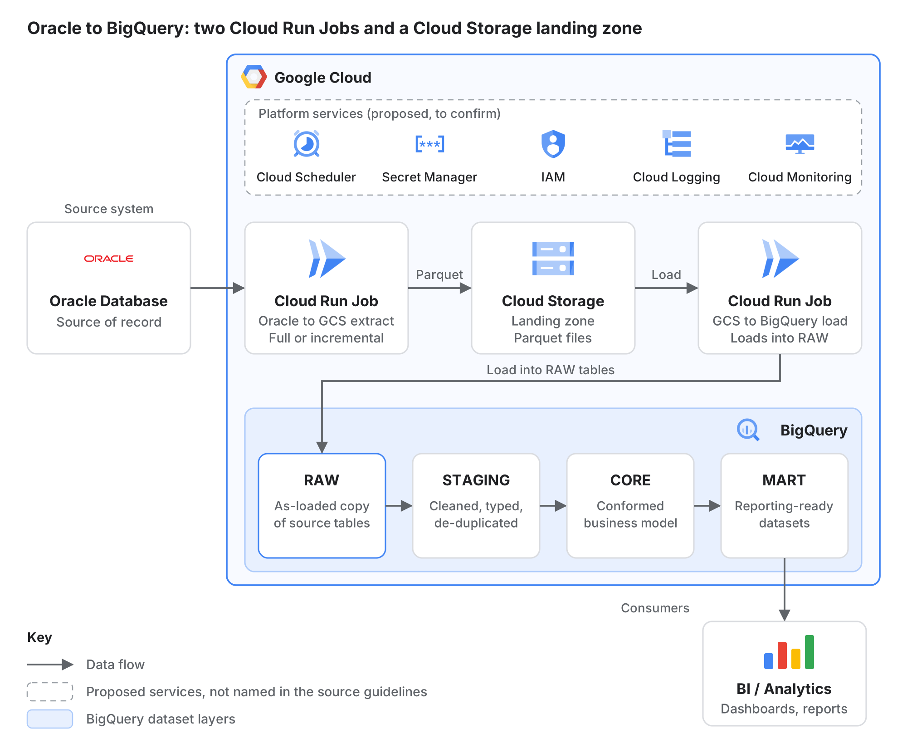
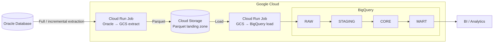

# Oracle to BigQuery Migration Framework

A standard, reusable framework for migrating data from **Oracle Database** to **Google BigQuery**. It supports full and incremental loads, checks every run against the source, and keeps an audit trail.

---

## Contents

- [Objectives](#objectives)
- [Architecture](#architecture)
- [Components](#components)
- [Data flow](#data-flow)
- [BigQuery layers](#bigquery-layers)
- [Audit and validation](#audit-and-validation)
- [Operational model](#operational-model)
- [Dependencies](#dependencies)
- [Assumptions](#assumptions)

---

## Objectives

| Objective | How the framework meets it |
| --- | --- |
| Scalable | Serverless Cloud Run Jobs for extract and load; storage and compute scale independently |
| Reusable | Two generic jobs driven by per-table configuration, not per-table code |
| Controlled | Every table goes through the same gated stages: extract, land, load, validate |
| Auditable | Each run records what was extracted, landed and loaded, with counts and status |
| Incremental | Full load on the first run, then incremental extraction of changed rows |
| Validated | Every run reconciles Oracle against Cloud Storage and BigQuery |
| Production-ready | Defined scheduling, monitoring, failure handling and security |

---

## Architecture

Oracle data reaches BigQuery in two separate steps. The **extract job** writes Parquet files to Cloud Storage, then the **load job** loads those files into BigQuery `RAW`. Cloud Storage is the hand-off point between the two jobs. If a load fails, it re-runs from the landed files without querying Oracle again, and the files also serve as the audit copy of each extract.

Text version of the diagram (Mermaid)

---

## Components

| Component | Service | Role |
| --- | --- | --- |
| Source | Oracle Database | System of record; read-only extraction |
| Extract job | Cloud Run Job (Oracle → GCS) | Reads each configured table in full or incremental mode and writes Parquet |
| Landing zone | Cloud Storage | Holds Parquet files per table and run; hand-off between the two jobs |
| Load job | Cloud Run Job (GCS → BigQuery) | Loads landed Parquet into BigQuery `RAW` |
| Warehouse | BigQuery | `RAW`, `STAGING`, `CORE` and `MART` layers |
| Consumption | BI / Analytics | Reads `MART` only |

**Proposed platform services** (to be confirmed):

| Service | Purpose |
| --- | --- |
| Cloud Scheduler | Triggers the jobs on a schedule |
| Secret Manager | Stores Oracle connection credentials |
| IAM service accounts | A least-privilege identity for each job |
| Cloud Logging | Job execution logs |
| Cloud Monitoring | Failure and freshness alerts |

---

## Data flow

Every table follows the same five steps:

1. **Extract**: read the table from Oracle, in full or incremental mode.
2. **Land**: write the result to Cloud Storage as Parquet.
3. **Load**: load the landed files into the matching BigQuery `RAW` table.
4. **Transform**: move data from `RAW` to `STAGING`, `CORE` and `MART`.
5. **Consume**: BI and analytics tools query `MART`.

| Mode | When it runs | What is read |
| --- | --- | --- |
| Full | Initial migration of a table; re-baselining after a correction | All rows |
| Incremental | Every scheduled run after the initial load | Rows changed since the last recorded watermark |

> Incremental extraction needs a reliable change column on each table, such as a last-modified timestamp or an increasing key. Tables without one stay on full extraction. How deletes in Oracle are captured is still to be decided.

---

## BigQuery layers

| Layer | Holds | Rule |
| --- | --- | --- |
| `RAW` | Source tables as loaded, plus load metadata (run ID, load time, source file) | No business logic; never edited by hand |
| `STAGING` | Cleaned data: Oracle types mapped to BigQuery types, standard names, duplicates from incremental loads removed | One staging table per source table |
| `CORE` | Business entities joined across source tables, with one shared definition each | Single agreed definition per entity |
| `MART` | Subject-area tables shaped for reporting | The only layer BI tools read |

---

## Audit and validation

A run counts as successful only when the data it loaded reconciles with what Oracle held.

**Audit trail.** Each run writes one record per table to an audit table in BigQuery. The record holds:

- run ID, table and extraction mode
- watermark range, start time and end time
- rows extracted, files written and rows loaded
- status and error text

The incremental watermark is read from this table.

| Check | Compares | On failure |
| --- | --- | --- |
| Row count | Oracle, Parquet and `RAW` | Fail the run; do not advance the watermark |
| Schema | Oracle columns and types against `RAW` | Fail the run; flag the schema change for review |
| Key integrity | Primary key not null and unique in `STAGING` | Block promotion to `CORE` |
| Aggregate reconciliation | Sums of selected numeric columns, Oracle against `RAW` | Raise for investigation |
| Freshness | Time since the last successful load per table | Alert when past the agreed threshold |

The watermark advances only after the load and the row-count check both pass. A failed run can therefore be repeated without losing or duplicating a change window.

---

## Operational model

| Area | Approach |
| --- | --- |
| Configuration | One entry per table: source schema and table, extraction mode, change column, key columns, target dataset. Adding a table means adding an entry, not writing code |
| Scheduling | Cloud Scheduler triggers the extract job; the load job runs after extraction completes |
| Re-runs | Both jobs can be re-run safely: re-running a window overwrites that run's files and does not duplicate rows in `RAW` |
| Failure handling | A failed table does not stop other tables; the audit record keeps the error and the watermark does not move |
| Monitoring | Cloud Logging for job logs; Cloud Monitoring alerts on job failure, validation failure and stale tables |
| Security | Oracle credentials in Secret Manager; one service account per job with least-privilege IAM roles; private network path to Oracle |
| Environments | Separate dev, test and prod projects using the same job images with different configuration |
| Retention | Lifecycle rule on the landing bucket deletes Parquet files after the agreed audit period |

---

## Dependencies

| Dependency | Owner |
| --- | --- |
| Read-only Oracle account with access to in-scope schemas | Oracle DBA team |
| Network connectivity from Cloud Run to Oracle | Network team |
| Google Cloud projects, datasets, buckets and service accounts | Cloud platform team |
| List of in-scope tables with keys, change columns and volumes | Source system owners |

---

## Assumptions

- The platform services listed under [Components](#components) are proposed and still to be confirmed.
- The layer responsibilities and validation checks are a proposed definition.
- Low-level code and troubleshooting procedures are out of scope here; they belong in the job source and runbooks.
